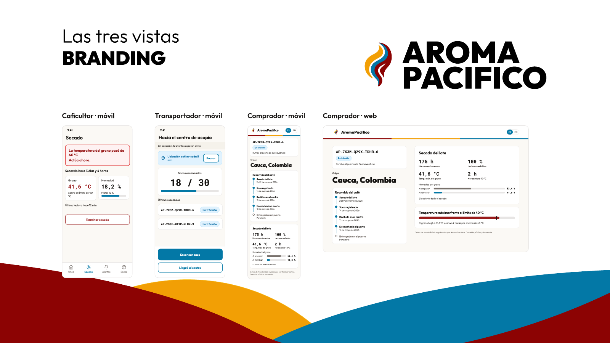

  <picture>
    <source media="(prefers-color-scheme: dark)" srcset="https://raw.githubusercontent.com/aromapacifico-devops/.github/main/profile/assets/logo-dark.png">
    
  </picture>

<b>Coffee traceability from the farm to the port of Buenaventura</b> 
Architecture, infrastructure code and cost of a traceability pilot for 200 coffee farms in Cauca, Huila and Tolima

The platform follows each sack of coffee from the farm where it dries, through the carrier and the collection center, to the port and the buyer. Farm sensors report crop and drying conditions even without signal, drones confirm and treat pests, and a buyer reads the history of one sack through a public query. It runs on a serverless AWS design, and a reusable infrastructure pattern builds each environment.

This is an academic case study of Universidad Icesi, 2026. Its figures, pilot and 2020 design are class material and do not describe an official project of the Federación Nacional de Cafeteros.

## Where to start

| Document | What it explains |
|---|---|
| [Architecture of the pilot](https://github.com/aromapacifico-devops/aromapacifico-devops-docs/blob/main/docs/architecture/overview.md) ([PDF](https://github.com/aromapacifico-devops/aromapacifico-devops-docs/blob/main/docs/architecture/overview.pdf)) | The whole platform, its flows, how each one fails, its scale, cost and assumptions |
| [Platform overview diagram](https://github.com/aromapacifico-devops/aromapacifico-devops-docs/blob/main/docs/architecture/diagrams/00-platform-overview.drawio.png) | Every site, service and link on one page |
| [Implementation scope](https://github.com/aromapacifico-devops/aromapacifico-devops-docs/blob/main/docs/architecture/implementation-scope.md) | Which parts of the architecture the infrastructure code builds |
| [Infrastructure code](https://github.com/aromapacifico-devops/aromapacifico-devops-infra#readme) | Environments, remote state, pipelines and how an environment goes up and down |
| [Verification](https://github.com/aromapacifico-devops/aromapacifico-devops-infra/blob/main/docs/verification.md) | The plan, apply, smoke test and teardown of the test environment, and what remains unproven |
| [Pilot cost](https://github.com/aromapacifico-devops/aromapacifico-devops-docs/blob/main/docs/governance/pilot-cost.md) ([PDF](https://github.com/aromapacifico-devops/aromapacifico-devops-docs/blob/main/docs/governance/pilot-cost.pdf)) | Cloud, farm hardware, links and drone campaigns at current prices |
| [Validation matrix](https://github.com/aromapacifico-devops/aromapacifico-devops-docs/blob/main/docs/qa/validation-matrix.md) | Each requirement and failure scenario with the document that answers it |
| [Design system](https://github.com/aromapacifico-devops/aromapacifico-devops-docs/blob/main/docs/design/design-system.md) | The visual identity and its components applied to the farmer, carrier and buyer screens |

## Repositories

| Repository | Content |
|---|---|
| [`aromapacifico-devops-docs`](https://github.com/aromapacifico-devops/aromapacifico-devops-docs) | Architecture, decisions, diagrams, cost and design documents |
| [`aromapacifico-devops-infra`](https://github.com/aromapacifico-devops/aromapacifico-devops-infra) | Terraform roots of each environment, bootstrap and deployment pipelines |
| [`terraform-aws-network`](https://github.com/aromapacifico-devops/terraform-aws-network) | VPC, subnets, routes, endpoints and the link to one collection center |
| [`terraform-aws-security`](https://github.com/aromapacifico-devops/terraform-aws-security) | Platform identities, encryption keys and permanent cloud firewall rules |
| [`terraform-aws-telemetry-ingestion`](https://github.com/aromapacifico-devops/terraform-aws-telemetry-ingestion) | Ingestion path from IoT Core to storage and alerts |
| [`terraform-aws-farm`](https://github.com/aromapacifico-devops/terraform-aws-farm) | Reusable identity of one farm |
| [`terraform-aws-inference-function`](https://github.com/aromapacifico-devops/terraform-aws-inference-function) | Event-driven inference function pattern |
| [`terraform-aws-module-template`](https://github.com/aromapacifico-devops/terraform-aws-module-template) | Template that starts a new module |
| [`.github`](https://github.com/aromapacifico-devops/.github) | This profile, issue and pull request templates, and the shared checks |

## How a change reaches production

Each Terraform module lives in its own repository with its own checks and versions. A merge to a module publishes a new version tag, and the infrastructure repository consumes every module through an exact tag.

1. Every pull request runs the shared checks, which cover format, validation, linting, security scanning and a search for secrets.
2. A pull request to the infrastructure repository also plans development, test and production, and comments what each environment would create and its monthly cost.
3. After the merge, a person deploys an environment from the pipeline. The pipeline plans, stores that plan and applies exactly that plan. Test then runs a smoke test that sends one simulated reading to the readings table.
4. Production waits for a named reviewer to approve the plan, and a harvest freeze blocks daytime changes during harvest weeks.
5. A weekly drift check compares each running environment with the code, and the same pipeline takes an environment down when work stops.
